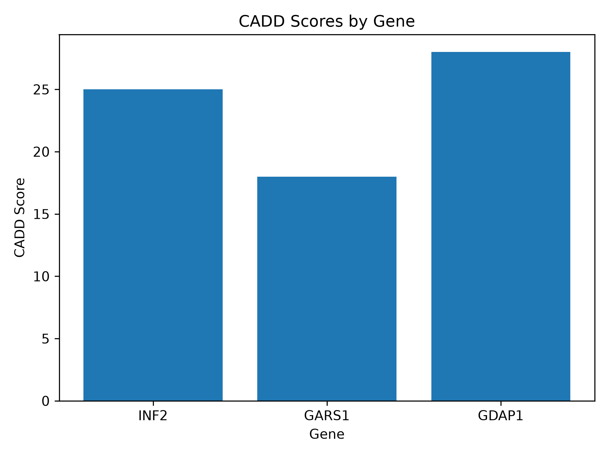

# SQL and Python for Genomic Data Analysis

## Project Overview

This project demonstrates a basic genomic variant analysis workflow using SQL, Python, pandas, and Matplotlib. It combines database querying, data filtering, ranking, and visualization in a reproducible learning project.

**Important:** All variant data used in this project are synthetic and intended for educational purposes only. They do not represent clinical evidence or diagnostic conclusions.

## Objectives

- Query structured genomic data using SQL and SQLite.
- Filter variants by allele frequency (AF) and CADD score.
- Load query results into pandas DataFrames.
- Sort and prioritize candidate variants using predefined criteria.
- Visualize CADD scores using Matplotlib.
- Practice version control and project documentation with Git and GitHub.

## Tools and Technologies

- Python
- SQLite
- SQL
- pandas
- Matplotlib
- Git and GitHub

## Project Structure

```text
sql-python-genomics-portfolio/
├── practice.sql
├── analyze_variants.py
├── plot_cadd.py
├── figures/
│   └── cadd_scores.png
└── README.md
```

The local SQLite database (`genomics.db`) is excluded from version control.

## Analysis Workflow

### 1. SQL Querying

SQL is used to retrieve variant records, filter by predefined criteria, calculate summary statistics, and organize results.

### 2. Variant Filtering with Python

The `analyze_variants.py` script:

- Connects to the local SQLite database.
- Loads variant records into a pandas DataFrame.
- Filters variants with AF ≤ 0.01 and CADD > 20.
- Sorts the remaining records by CADD score in descending order.

### 3. Data Visualization

The `plot_cadd.py` script creates a bar chart comparing CADD scores across genes and saves the figure as a high-resolution PNG file.



## Synthetic Dataset

The practice dataset contains three example gene records: INF2, GARS1, and GDAP1, with allele frequency and CADD score fields.

The filtering criteria are simplified educational examples. CADD scores and allele frequency alone are not sufficient to establish variant pathogenicity.

## Running the Project

### Requirements

Install the Python packages:

```bash
py -m pip install pandas matplotlib
```

SQLite is accessed through Python's built-in `sqlite3` module.

### Database Setup

The local database must contain a `variants` table with the columns `gene`, `AF`, and `CADD`.

Example setup using Python:

```python
import sqlite3

connection = sqlite3.connect("genomics.db")

connection.execute("""
CREATE TABLE IF NOT EXISTS variants (
    gene TEXT,
    AF REAL,
    CADD REAL
)
""")

connection.executemany(
    "INSERT INTO variants (gene, AF, CADD) VALUES (?, ?, ?)",
    [
        ("INF2", 0.0004, 25.0),
        ("GARS1", 0.02, 18.0),
        ("GDAP1", 0.001, 28.0),
    ]
)

connection.commit()
connection.close()
```

Run this setup only once for a new database to avoid inserting duplicate records.

### Run the Analysis

```bash
py analyze_variants.py
```

### Generate the Visualization

```bash
py plot_cadd.py
```

## Learning Outcomes

This project demonstrates practical experience with SQL querying, relational database access, pandas-based data manipulation, basic genomic data prioritization, scientific visualization, and Git-based project management.

## Future Improvements

- Expand the synthetic dataset.
- Add more exploratory data visualizations.
- Integrate additional variant annotation fields.
- Develop more advanced SQL queries and summary reports.

---

**Disclaimer:** This is an educational programming project, not a clinical variant interpretation or diagnostic tool.
